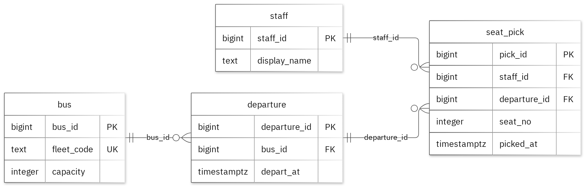

# MIT 8103 Advanced Database Systems

**Daily Staff Commute Seat Picker** · Chinazo Kalu · Student ID 301853302

## Case study

My case study is Daily Staff Commute Seat Picker. I designed the database for synthetic staff members selecting seats and synthetic transport coordinators reviewing departures, with separate tables named staff, bus, departure and seat_pick. It supports these operations: create a departure for one bus and record a staff member's seat pick; list picked seats and compare occupied seats with bus capacity; benchmark a departure_id filter on synthetic data: compare equivalent query plans before and after a B-tree index using 20000 SeatPick rows.

## Portfolio 1: Database Design and Modelling

I organised the relational design into 4 tables. Primary keys identify records, foreign keys preserve the links, and checks enforce the stated business rules. A bus must have capacity greater than zero. The normalisation examples show the sample data at 1NF, 2NF and 3NF. All 13 deliberately invalid inserts were rejected without changing the valid sample rows.

Figure 1. Tables, keys and relationships. PK: primary key; FK: foreign key; UK: unique value.

<!-- PAGE BREAK -->

## Portfolio 2: Query Processing and Optimisation

I ran three SQL queries against the sample records. The join returned 2 rows and included Avery Chen with FLEET-101. For the index comparison, I used 20,000 separate performance rows. The median lookup time changed from 0.851 ms to 0.197 ms. Both phases returned the same records. The measured plan used the new index. These timings apply to this lookup and environment.

## Portfolio 3: Transactions and Concurrency

I used a temporary counter on seat_pick to test COMMIT, ROLLBACK and READ COMMITTED isolation. The uncommitted update remained hidden from the other session, and ROLLBACK restored the earlier committed value. Without locking, two increments left the counter at 2. With SELECT FOR UPDATE, Session B waited for Session A and the final value was 3. The helper is confined to this exercise; the case's original business fields stay unchanged.

## Portfolio 4: NoSQL and Advanced Data Models

I used seat_pick_events for the case's event documents. MongoDB inserted 4 sample events and returned the expected results for 4 queries. Validation rejected an invalid date type and a duplicate event ID. Embedded snapshots keep related details with an event, while the details field can differ by event type. These are fictional events; PostgreSQL continues to enforce its relational rules.

## Repository and evidence

https://github.com/ckalu3302-art/Kalu_Chinazo_301853302

The portfolio folders contain the SQL and JavaScript, explanations, query plans, result tables and screenshots.

<!-- PAGE BREAK -->

## Portfolio 5: Distributed and Cloud Database Exercise

I proposed three MongoDB replica members across separate failure zones. The discussion covers primary elections, majority acknowledgement, secondary lag and sharding trade-offs for seat_pick_events. Replication supports availability, while backups address recovery. PostgreSQL needs its own availability plan. This is the permitted discussion option; no live replica set or failover test was deployed.

## Individual reflection

I kept staff, bus, departure, seat_pick in separate tables so their details could be maintained without repeating them in every related record. A bus must have capacity greater than zero. The constraint tests check this alongside the required values and record links. One issue illustrated by the two-session exercise is that both sessions can read the same value before either update is committed. Locking the row before reading preserves both increments. The index comparison also shows why I need to check the execution plan as well as the final answer: the same result can require different amounts of database work.

## AI-use declaration

I used GitHub Copilot and the portfolio generator to help prepare the database model, scripts and explanations. The generator ran the PostgreSQL and MongoDB exercises, checked their outputs and captured the result images.  I remain responsible for checking and explaining the submitted work.

## References

- [PostgreSQL: constraints](https://www.postgresql.org/docs/17/ddl-constraints.html)
- [PostgreSQL: EXPLAIN](https://www.postgresql.org/docs/17/using-explain.html)
- [PostgreSQL: isolation](https://www.postgresql.org/docs/17/transaction-iso.html)
- [PostgreSQL: row locks](https://www.postgresql.org/docs/17/explicit-locking.html)
- [MongoDB: data modelling](https://www.mongodb.com/docs/manual/data-modeling/)
- [MongoDB: replication](https://www.mongodb.com/docs/manual/replication/)
- [MongoDB: sharding](https://www.mongodb.com/docs/manual/sharding/)
- [Mermaid: ER diagrams](https://mermaid.js.org/syntax/entityRelationshipDiagram.html)

